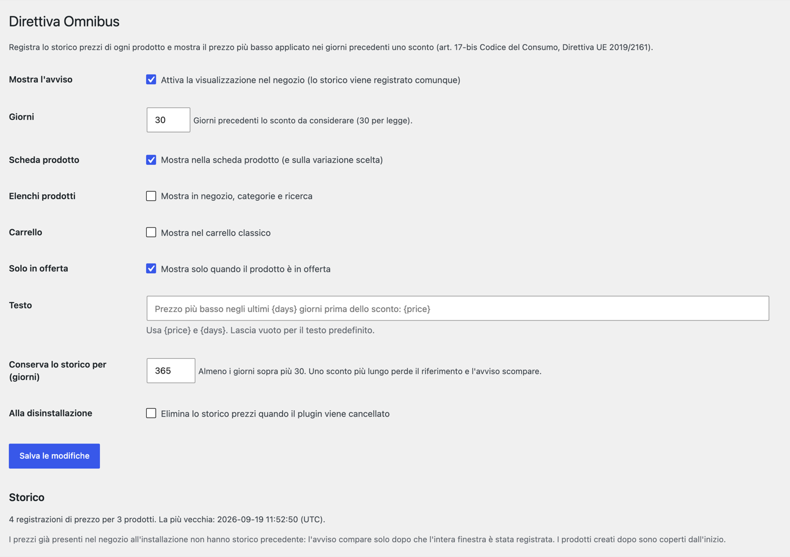

# Threecommerce Omnibus: EU Omnibus Directive price notice for WooCommerce

A WooCommerce plugin for the **Omnibus Directive** (EU 2019/2161; in Italy art. 17-bis of the Consumer Code, Legislative Decree 26/2023). It keeps the **price history** of every product and, when a product is on sale, shows under the price the **lowest price applied in the 30 days before the discount**. It is the WooCommerce port of our Magento 2 module.

**Compatibility:** WordPress 6.0+ · WooCommerce 8.0+ · PHP 8.1 – 8.4 · HPOS · Block-based checkout
**License:** commercial · coming soon

## Features

- **Price history** of simple products and variations: a row is saved whenever the effective price changes (admin save, quick and bulk edit, REST API, scheduled sales). A daily job catches changes that bypass WooCommerce (SQL imports, other plugins) and prunes the history beyond the retention period.
- **Reference price**: the lowest price in force in the *N* days (30 by default, 1–365) before the discount was applied. With successive reductions (100 → 80 → 70) the reference stays the one before the first reduction.
- **Notice under the price**, shown only when the current price is lower than the reference and the history covers the whole window. **No data is invented**: with not enough history nothing is shown.
- **Configurable text** with the `{price}` and `{days}` placeholders. Default (Italian): *Prezzo più basso negli ultimi {days} giorni prima dello sconto: {price}*.
- Where to show it: **product page**, **product lists**, **classic cart**; block themes get it on the *Product Price* block.
- **Variable products**: the notice follows the selected variation; on the parent product (price range) it appears only when every variation qualifies.
- The reference price follows the shop's **tax display** setting (incl. or excl. tax).
- Off by default, but the history is recorded from activation, so it is complete when you switch the notice on.
- Italian translation included.

## Requirements

- WordPress 6.0 or newer
- PHP 8.1 – 8.4
- WooCommerce 8.0 or newer

## Known limits

- Prices already in the shop when the plugin was installed have no earlier history: for those products the notice appears only after the full 30-day window has been recorded. Products created while the plugin is active are covered from the start.
- A discount longer than the retention period loses its reference and the notice disappears (raise the retention).
- The plugin does not change WooCommerce's struck-through price: it adds a line under the price.
- The notice is not shown in the block-based cart and checkout (classic cart only); grouped products have no notice.
- Changes made by SQL are dated at the time of the daily job, not at the real time.
- A support tool: tax and legal compliance remains the responsibility of the shop.

## Tested with

The price-reference calculation is covered by automated unit tests, and the plugin has been run end to end on a local WordPress 7.1 / WooCommerce 10.9 installation (simple and variable products, discount chains, price changes made outside WooCommerce). It has not yet been tested on a live shop. The screenshots above are taken from that local installation.

## Availability

This plugin is **not yet available for purchase**. See the [product page](https://www.threecommerce.it/omnibus-woocommerce?utm_source=github&utm_medium=readme&utm_campaign=woocommerce-omnibus) for its status, or [get in touch](https://www.threecommerce.it/contatti?utm_source=github&utm_medium=readme&utm_campaign=woocommerce-omnibus) to be notified at launch or to ask for information.

## Configuration

*WooCommerce → Omnibus*: show the notice, days, where to show it (product page, lists, cart), only on sale, text, history retention and what to do with the history on uninstall.

## Documentation and support

- Product page: [threecommerce.it/omnibus-woocommerce](https://www.threecommerce.it/omnibus-woocommerce?utm_source=github&utm_medium=readme&utm_campaign=woocommerce-omnibus)
- [Changelog](CHANGELOG.md) (in Italian)
- Support and custom development: [threecommerce.it/contatti](https://www.threecommerce.it/contatti?utm_source=github&utm_medium=readme&utm_campaign=woocommerce-omnibus)

---

*This repository is the public showcase of the plugin. The source code is kept in a private repository.*
